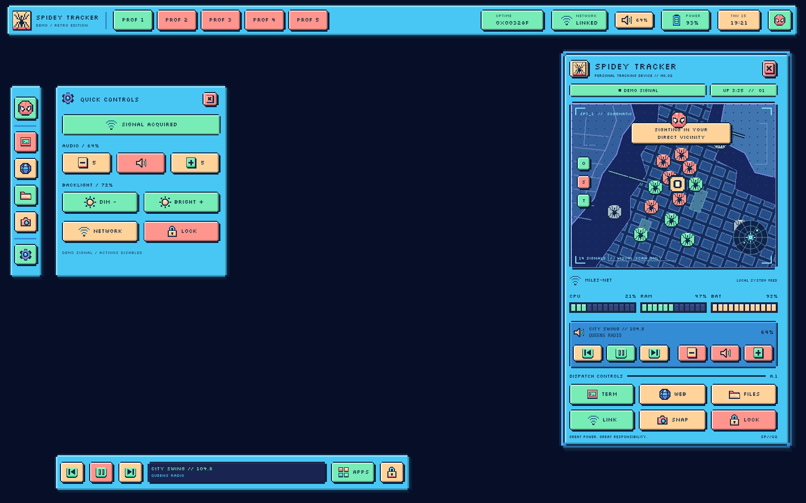

> **New photo-based retro variant:** cyan/navy frames, salmon and mint pixel buttons, and bitmap icons. See the [retro UI and install guide](docs/retro.md). It lives in `quickshell-retro/` on `feat/spidey-tracker-retro`; the original rice below remains available on `main` and its `quickshell/` files are unchanged.

# SPIDEY TRACKER // Linux rice

A Hyprland + Quickshell desktop inspired by the [Spidey Tracker](https://spideytracker.net/intl/br/) interface: charcoal panels, signal-red accents, square pixel buttons, a city-map wallpaper and a tracking dashboard.



The reference website was inaccessible from the build environment. This design is an original interpretation of the requested tracker/movie direction; fidelity to the site's exact layout and assets has not been verified.

The shell includes a top bar on each display, numbered workspaces, an animated tracker, live CPU/RAM/disk readings, battery and network status, audio/brightness controls, MPRIS media controls and app shortcuts. The tracker map is decorative; device statistics come from your machine. A bundled pixel font and SVG icons keep the interface consistent without an icon theme or Nerd Font.

## Requirements

Use a Linux desktop with a working Wayland/Hyprland session. This is a set of dotfiles, not a Linux distribution or a display manager.

| Component | Purpose |
| --- | --- |
| Hyprland | Compositor; Lua starter targets **0.55+**, based on the official **0.56.2** example. Legacy `.conf` files target **0.48–0.54**. |
| Quickshell **0.2.1+**, Qt 6 | Panel and dashboard; executable may be named `qs` or `quickshell`. |
| Python **3.10+** | Telemetry/action bridge; standard library only, no pip dependencies. |
| Bash, GNU coreutils | Installation and wallpaper launcher. |
| DejaVu Sans Mono | Readable telemetry text; the Silkscreen pixel font is bundled. |

Install the desktop tools you want to use:

| Package/tool | Feature |
| --- | --- |
| `kitty` | Terminal, with matching theme. |
| `hyprpaper` | Wallpaper; the launcher supports 0.7 and 0.8 config formats. |
| `wireplumber` (`wpctl`), PipeWire | Volume status, mute and volume buttons. A working user audio session is required. |
| `brightnessctl` | Laptop backlight controls; depends on available hardware and user permissions. |
| `playerctl` | Playback controls for an MPRIS-compatible player. |
| `networkmanager` (`nmcli`) | Connection names; basic link status also works without it. |
| `network-manager-applet` (`nm-connection-editor`) | Network settings button. Existing NetworkManager service required. |
| `fuzzel` | Application launcher. |
| `xdg-utils`, a file manager, `firefox` | File and browser shortcuts. |
| `grim`, `slurp`, `wl-clipboard` | Region screenshots and the Print shortcut. |
| `hyprlock` | Lock screen with the supplied config; existing PAM configuration required. |

On Arch Linux, review this package list and install what your system needs:

```sh
sudo pacman -S --needed hyprland quickshell python qt6-declarative qt6-svg \
  ttf-dejavu kitty hyprpaper wireplumber brightnessctl playerctl \
  networkmanager network-manager-applet fuzzel xdg-utils thunar firefox \
  grim slurp wl-clipboard hyprlock
```

No install script runs a package manager, enables services, or changes your login session. If you already use a different network or audio stack, keep it and omit those packages. Debian/Ubuntu repositories may ship older Hyprland or omit Quickshell; use a supported package for your distribution and check versions before choosing the config format. Qt QML module package names also vary by distribution.

## Install safely

Keep this checkout where you want the dotfiles to live; installation uses symlinks.

```sh
git clone https://github.com/need0auth/linux-rice.git
cd linux-rice
bash scripts/install.sh --dry-run
bash scripts/install.sh
```

The installer creates three links under `${XDG_CONFIG_HOME:-$HOME/.config}`:

| Installed path | Repository source |
| --- | --- |
| `quickshell/spidey` | `quickshell/` |
| `hypr-spidey` | `config/hypr/` |
| `kitty-spidey` | `config/kitty/` |

Existing files cause the whole preflight to stop before installation. Use `--backup` only if you want conflicts moved to unique `.spidey-backup.*` paths. Your main Hyprland and Kitty configuration files are never edited. `--config-root /absolute/path` installs into another directory; export `XDG_CONFIG_HOME` to that directory when starting the shell or Lua starter. For legacy Hyprland, set `$spideyConfigRoot` to the same absolute path.

### Existing Hyprland desktop

Check `hyprctl version` first. For **0.55+**, add this to your existing Lua config:

```lua
local config_root = os.getenv("XDG_CONFIG_HOME") or (os.getenv("HOME") .. "/.config")
dofile(config_root .. "/hypr-spidey/rice.lua")({ config_root = config_root })
```

For **0.48–0.54**, add these lines to your existing `hyprland.conf`:

```ini
$spideyConfigRoot = ~/.config
source = $spideyConfigRoot/hypr-spidey/rice.conf
```

The sourceable rice applies appearance, key bindings and startup commands. Review conflicts with your own bindings and stop any existing bar if you do not want two panels. It leaves monitor definitions and keyboard layout to your main config. The supplied starter uses a US keyboard; change `kb_layout` to `br` if needed.

Reload with `hyprctl reload`. Startup commands run on a **new session**, so start Quickshell and the wallpaper manually when trying the rice inside an existing session:

```sh
qs -c spidey
# In another terminal, if you want the supplied wallpaper:
bash ~/.config/hypr-spidey/wallpaper.sh
```

Replace `qs` with `quickshell` if that is your executable name. For a full standalone config, choose the matching starter from a TTY or your session manager:

```sh
# Hyprland 0.55+
Hyprland --config ~/.config/hypr-spidey/hyprland.lua

# Hyprland 0.48–0.54
Hyprland --config ~/.config/hypr-spidey/hyprland.conf
```

### Preview without changing your desktop

Run the shell directly from the checkout:

```sh
SPIDEY_PREVIEW=1 SPIDEY_DEMO=1 qs -p "$PWD/quickshell"
```

This opens a desktop scene in a normal window with sample telemetry and disabled desktop actions. For a headless visual check, use `QT_QPA_PLATFORM=offscreen` with the same command; it does not create a usable compositor session. Live mode requires Hyprland and the appropriate desktop tools. Without `SPIDEY_DEMO`, the shell reads real system statistics and available devices.

The [windowed preview](docs/preview.png) adds presentation text and two launch buttons over the wallpaper. Live mode draws the top bar and dashboard over your applications, as shown in the screenshot above.

Save a headless render to a file:

```sh
QT_QPA_PLATFORM=offscreen QT_QUICK_BACKEND=software \
  SPIDEY_PREVIEW=1 SPIDEY_DEMO=1 SPIDEY_SCREENSHOT="$PWD/docs/preview.png" \
  qs -p "$PWD/quickshell"
```

`SPIDEY_SCREENSHOT` saves the preview and exits. This runs locally without a browser server or loopback networking.

## Controls

| Shortcut | Action |
| --- | --- |
| `Super + D` | Show/hide the tracking dashboard. |
| `Super + Enter` | Open the themed Kitty terminal. |
| `Super + Space` | Application launcher. |
| `Super + E` | File manager. |
| `Super + Q` | Close the focused window. |
| `Super + F` / `Super + V` | Fullscreen / toggle floating. |
| `Super + arrows` | Move focus. |
| `Super + Shift + arrows` | Move the focused window. |
| `Super + 1…0` | Switch to workspace 1…10. |
| `Super + Shift + 1…0` | Move the focused window to workspace 1…10. |
| `Super + left/right mouse drag` | Move / resize a window. |
| `Super + L` | Lock with the bundled Hyprlock config. |
| `Print` | Select a region and copy it to the clipboard. |
| `Super + Shift + R` | Reload Hyprland configuration. |

The dashboard screenshot button saves a selected region to `~/Pictures/SpideyTracker/`. Keyboard volume, brightness and media keys use the corresponding optional tools. The network button opens a settings application; it does not join or disconnect networks itself.

Toggle the dashboard from a terminal or another launcher:

```sh
qs -c spidey ipc call dashboard toggle
```

## Customize

- `quickshell/services/Theme.qml`: shell colors, fonts and 52px bar height.
- `quickshell/assets/wallpaper.png`: generated wallpaper.
- `quickshell/assets/icons/`: editable pixel SVG icons.
- `quickshell/scripts/system.py`: telemetry and a fixed set of desktop actions.
- `config/hypr/rice.lua` or `rice.conf`: compositor appearance and bindings.
- `config/hypr/hyprlock.conf`: matching lock screen.
- `config/kitty/kitty.conf`: terminal palette.

The bundled Silkscreen font is licensed under the SIL Open Font License; see `quickshell/assets/fonts/OFL.txt`. Artwork and icons in this rice are custom assets inspired by the reference; this is an unofficial fan project.

## Validate and troubleshoot

```sh
python3 -m unittest discover -s tests -v
python3 quickshell/scripts/system.py --demo snapshot
python3 quickshell/scripts/system.py snapshot
bash -n scripts/install.sh scripts/uninstall.sh config/hypr/wallpaper.sh
```

If Quickshell reports a missing QML module, install the matching Qt 6 module from your distribution. An unavailable control usually means its optional program, device or user service is absent; CPU, RAM, disk and uptime do not need those tools. Hardware behavior, screen locking, compositor effects, screenshots and real device actions need validation in an actual Hyprland session. Cloud/headless checks cannot establish that hardware works.

Development verification passed 28 backend/installer tests, actual Quickshell 0.2.1 rendering with Qt 6.8.2, live telemetry, dashboard IPC, and production layer-shell panels under headless Sway. The Hyprland Lua API was checked against official v0.56.2 sources; native Hyprland workspace switching and hardware actions have not been exercised here. See [validation details](docs/validation.md).

To remove the installed links:

```sh
bash scripts/uninstall.sh --dry-run
bash scripts/uninstall.sh
```

Then remove the source/autostart lines you added. The uninstaller leaves unrelated files and all backups intact. Restore any backup manually after reviewing it.
