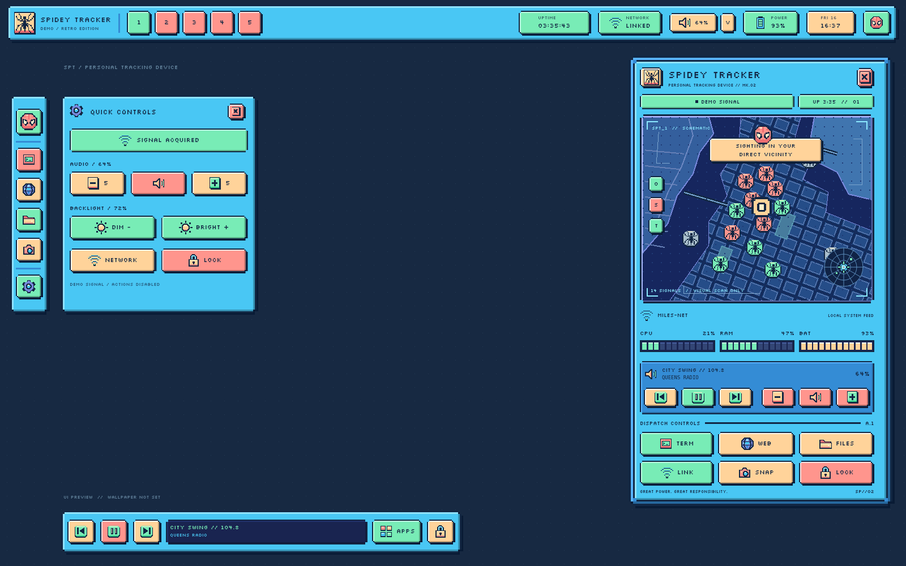
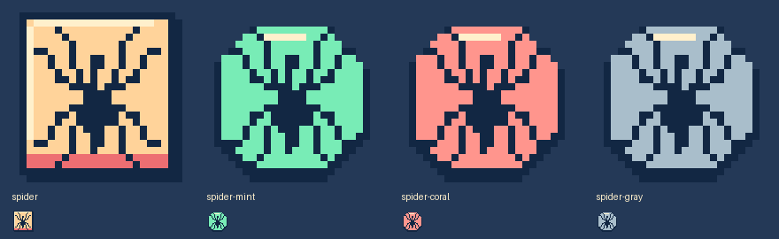

# Spidey Tracker // Arch Linux rice

[](https://github.com/need0auth/linux-rice/actions/workflows/arch.yml)

A Hyprland + Quickshell desktop based on the supplied tracker reference: chunky cyan frames, navy panels, coral and mint buttons, peach keys, and illustrated pixel icons. This is the default rice on `main`. The previous black/red variant has been removed from the working tree.



The shell provides numbered workspace buttons, an app rail, media dock, quick settings and a tracker dashboard. CPU, memory, storage, network, battery and media readings come from your machine. The map is decorative and collects no location data. A matching Hyprlock screen and generated pixel-art city wallpaper are included. Applying the wallpaper and replacing the boot login screen are optional.

The top bar, left rail and bottom dock reserve compositor space, so tiled windows stay clear of them. The tracker and quick settings are popups. Transparent areas around the bars pass clicks through.

## Install on Arch Linux

These steps are for a first installation on Arch with an existing working Hyprland session. Already installed an earlier rice? Use [Updating either previous version](#updating-either-previous-version).

### 1. Install packages and link the dotfiles

Install the shell and the tools used by the current buttons. The defaults are **Kitty, Brave, Nemo and the themed Rofi launcher**:

```sh
sudo pacman -Syu --needed git hyprland quickshell qt6-svg python ttf-dejavu \
  kitty rofi nemo wireplumber playerctl brightnessctl grim slurp wl-clipboard \
  hyprlock networkmanager nm-connection-editor
git clone --branch main https://github.com/need0auth/linux-rice.git
cd linux-rice
bash scripts/install.sh --dry-run
bash scripts/install.sh
bash scripts/check-arch.sh
```

Run the dotfile installer as your normal desktop user, without `sudo`. The installer links configuration files; it does not install packages or enable services. Keep your existing working PipeWire and network setup. NETWORK opens NetworkManager settings by default; [app preferences](#preferred-applications) can select another settings tool.

Keep your existing Brave installation, or install your preferred browser separately and select it in [app preferences](#preferred-applications). Brave is not installed by the command above. Discord, Obsidian and Spotify are also your own applications; installed desktop entries appear in APPS. Vim desktop entries use the configured terminal.

Stable `quickshell` is in Arch's official repositories; no AUR helper is required for the shell. Pacman resolves its Qt dependencies. Keep Quickshell and Qt upgraded together with `pacman -Syu`. The bundled Silkscreen font is loaded directly by the shell.

Installation creates these links, so keep this checkout in place:

| Installed path | Repository directory |
| --- | --- |
| `~/.config/quickshell/spidey` | `quickshell/` |
| `~/.config/hypr-spidey` | `config/hypr/` |

On a first install, add the Hyprland load line in step 2 yourself. On upgrades, the installer migrates recognized older Spidey references with backups and restarts an existing Spidey bar. Unrelated conflicting files stop the preflight; `--backup` preserves and replaces those conflicts. Personal app preferences are preserved.

For an offline install, complete the remaining steps after entering Hyprland. `--no-restart` updates files without reloading Hyprland or restarting bars. `--config-root /absolute/path` selects a custom root; export `XDG_CONFIG_HOME` to that same root before installation and shell startup.

### 2. Connect it to Hyprland

Use the version reported by `bash scripts/check-arch.sh` or `hyprctl version`. Current **Hyprland 0.55+ uses Lua**. Add this once to the Lua configuration loaded by your session, usually `~/.config/hypr/hyprland.lua`:

```lua
local config_root = os.getenv("XDG_CONFIG_HOME") or (os.getenv("HOME") .. "/.config")
dofile(config_root .. "/hypr-spidey/rice.lua")({ config_root = config_root })
```

For an existing **Hyprland 0.48–0.54** installation, add this once to `~/.config/hypr/hyprland.conf` instead:

```ini
$spideyConfigRoot = ~/.config
source = $spideyConfigRoot/hypr-spidey/rice.conf
```

With `--config-root`, replace `~/.config` in the legacy snippet with the same absolute config root used by the installer.

Keep your monitor definitions, keyboard layout and device settings. The snippet applies the rice's styling and bindings and registers Spidey for the next Hyprland session. Disable your previous bar's startup entry, such as Waybar, when switching to Spidey.

The snippet already autostarts Spidey with `--no-duplicate`; keep one Spidey startup entry. If you manage it through your own `autostart.lua`, use this load call in place of the default Lua call above:

```lua
local config_root = os.getenv("XDG_CONFIG_HOME") or (os.getenv("HOME") .. "/.config")
dofile(config_root .. "/hypr-spidey/rice.lua")({
    config_root = config_root,
    autostart = false,
})
```

Then add the launch to your existing startup handler, or use this handler if you do not have one:

```lua
hl.on("hyprland.start", function()
    hl.exec_cmd("qs -c spidey --no-duplicate")
end)
```

### 3. Start it in the current session

A fresh installation does not start the bar automatically. Reloading Hyprland also does not run its next-session startup handler. Close your previous bar's running instance, then launch Spidey once:

```sh
hyprctl reload
qs -c spidey --no-duplicate --daemonize
```

Use `quickshell` in place of `qs` if that is your executable name. For a new Hyprland session, the complete starter can be launched from a TTY with `Hyprland --config ~/.config/hypr-spidey/hyprland.lua` for 0.55+, or the `.conf` equivalent for older supported versions. The starter uses a US keyboard; change `kb_layout` to `br` if appropriate.

### 4. Check the installation

From your Arch Hyprland desktop, run:

```sh
bash scripts/check-arch.sh --session
```

Click a numbered workspace, TERM, WEB, FILES, APPS and NETWORK. Files should open Nemo, WEB should open Brave when installed, and APPS should show the pastel Rofi menu. Play a YouTube video or Spotify track to check the dock; see [media troubleshooting](#brave-youtube-and-spotify-media) if its title is absent. Tiled windows should stay clear of the top, left and bottom bars.

The package command in step 1 includes the following tools. You can omit tools for controls you do not use:

| Tool | Control |
| --- | --- |
| `kitty`, your existing Brave installation, `nemo` | Default terminal, browser and files. Kitty keeps your normal configuration. |
| `rofi` | APPS launcher with the cyan/navy/pastel theme; Fuzzel and Wofi are fallbacks. |
| `wpctl` from `wireplumber` | Volume and mute, with an existing working PipeWire session. |
| `playerctl` | Playback and metadata from MPRIS players. |
| `brightnessctl` | Backlight controls, subject to hardware and user permissions. |
| `nmcli`, `nm-connection-editor` | Connection names and settings, with an existing NetworkManager service. |
| `grim`, `slurp`, `wl-copy` | Region screenshots and clipboard capture. |
| `hyprlock` | Matching pixel-frame lock screen, city wallpaper and Arch's PAM authentication. |

Missing tools or devices disable the corresponding readings/controls or produce an action message. CPU, RAM, storage and uptime need only Python and Linux's system interfaces. Audio routing, backlight permissions and locking depend on your existing desktop services and hardware.

Use `bash scripts/check-arch.sh --all-tools --session` only when you want every optional tool to be required, including brightness and locking tools that may not apply to your setup.

Press `Super + L` or use the dock's lock button to try the new lock screen. See [lock screen, boot login and wallpaper](docs/appearance.md) for the bundled wallpaper, the optional graphical greetd login screen, or colors for your existing Ly login. The normal dotfile installer keeps your current login manager.

## Preferred applications

Edit [quickshell/config/apps.json](quickshell/config/apps.json) to change what the buttons launch. Defaults prefer **Kitty, Brave and Nemo**. Each action contains an ordered list of argument arrays; the first installed executable wins. Files launches a real file manager directly, so your folder MIME association cannot send it to an editor. The top-bar NETWORK button opens your configured network settings app.

For preferences that survive `git pull`, create `~/.config/spidey/apps.json` (or `$XDG_CONFIG_HOME/spidey/apps.json`). Include only the actions you want to replace:

```json
{
  "terminal": [["kitty"]],
  "browser": [["brave"]],
  "files": [["nemo", "{home}"]]
}
```

Available keys are `terminal`, `browser`, `files`, `network`, `launcher` and `lock`. Arguments support `{home}`, `{config}` and `{shell}` path tokens. Keep each argument separate; these commands do not run through a shell. Changes apply on the next click. The provided Hyprland terminal/files/launcher shortcuts use the same preferences after `hyprctl reload`.

APPS opens the bundled [Rofi theme](quickshell/assets/rofi.rasi). Installed desktop entries such as Discord, Obsidian, Spotify and Brave appear in its searchable list. Rofi uses your configured terminal for terminal entries such as Vim. You can replace `launcher` with your own Rofi command or another launcher.

## Brave, YouTube and Spotify media

The dock reads MPRIS sessions through `playerctl`, including Brave sessions named `chromium.instance…`. Playing sessions take priority over paused players. The transport buttons address the exact session displayed in the dock. If several players are playing, selection is stable by player name.

While a YouTube video is playing in Brave, check:

```sh
playerctl --list-all
playerctl --all-players status
playerctl --all-players metadata --format '{{playerName}}: {{title}}'
```

If Brave is absent, the browser is not exporting a media session to your desktop bus. Check its launch arguments and media controls settings for disabled MPRIS/media integration, then restart Brave. Browser flags vary by version; no browser extension is required when MPRIS is available. The bar cannot read video metadata from audio alone. Spotify desktop also works when it exports MPRIS.

## Updating either previous version

Update from this checkout and run the installer; you do not need to stop the old bar yourself:

```sh
git switch main
git pull --ff-only
bash scripts/install.sh --dry-run
bash scripts/install.sh
```

The installer recognizes both previous layouts. It reuses canonical links (including equivalent relative links), backs up aliases to the retired source, and removes only this checkout's retired `spidey-retro`, `hypr-spidey-retro` and `kitty-spidey` links. Unknown files, foreign links and earlier backups stay intact. If you moved to another checkout, use `--backup` for conflicting canonical links rather than deleting your old files.

Recognized `dofile`/`source` lines and plain Quickshell startup/IPC commands are migrated to the current names. Startup commands gain `--no-duplicate`. The former rice's wallpaper startup and Kitty theme include are commented out, leaving other wallpaper and terminal settings alone. Each changed file gets an adjacent `.spidey-backup.<timestamp>.<pid>` copy. External symlinks and complex expressions are left unchanged with a review notice.

On an active Wayland desktop, it stops only verified Spidey instances belonging to this checkout on the current display, reloads Hyprland when available, and starts one current bar if one was already running. Other Quickshell configs and sessions remain running. `--no-restart` updates files without touching live processes or reloading Hyprland. Offline installs update files for your next login. Personal `~/.config/spidey/apps.json` overrides are never replaced.

The old `install-retro.sh` and `quickshell-retro/` paths are retired.

## Controls

| Control | Action |
| --- | --- |
| Top-bar numbered buttons | Switch to workspaces 1–5, including empty workspaces; fewer on narrow screens. |
| Top-bar NETWORK | Open configured network settings. |
| Top-bar UPTIME | Elapsed time as `HH:MM:SS`, or `Nd HH:MM` after a day. |
| Left rail | Tracker, terminal, browser, files, screenshot and settings. |
| Gear button | Show/hide volume, brightness, network and lock controls. |
| Bottom dock | Media controls/title, launcher and lock. |
| Tracker `O`, `S`, `T` | Toggle local map overlays. |
| `Super + D` | Toggle tracker. |
| `Super + Enter`, `Super + Space`, `Super + E` | Terminal, launcher, files. |
| `Super + Q`, `Super + F`, `Super + V` | Close, fullscreen, floating. |
| `Super + arrows` | Focus; add Shift to move the window. |
| `Super + 1…0` | Workspace; add Shift to move the window there. |
| `Super + L`, `Print` | Lock; select and copy a screenshot. |

The dashboard screenshot button saves to `~/Pictures/SpideyTracker/`. Both popups start open and can be closed. Short displays scroll the tracker without shrinking controls. Terminal IPC:

```sh
qs -c spidey ipc call dashboard toggle
qs -c spidey ipc call dashboard controls
```

## Preview and customize

```sh
SPIDEY_PREVIEW=1 SPIDEY_DEMO=1 qs -p "$PWD/quickshell"
```

This opens the [windowed preview](docs/preview.png) over a neutral grid. Demo mode is labeled and disables desktop actions. Omit `SPIDEY_DEMO` for real measurements. `SPIDEY_PREVIEW_WIDTH` and `SPIDEY_PREVIEW_HEIGHT` set the window size. The desktop wallpaper stays under your existing wallpaper manager; the generated image is available in `assets/wallpapers/`.

- Colors/fonts: `quickshell/services/Theme.qml`.
- Reserved edge sizes: `barHeight`, `railReserve` and `dockReserve` in the same theme file (76px top, 100px left and 98px bottom by default).
- Frames/buttons: `quickshell/components/PixelFrame.qml` and `RetroButton.qml`.
- Icons: `quickshell/assets/icons/`; rebuild with `python3 tools/generate-icons.py`.
- Preferred apps: `quickshell/config/apps.json`, or your personal `~/.config/spidey/apps.json` override.
- Telemetry/actions: `quickshell/scripts/system.py`.
- Hyprland and lock screen: `config/hypr/`.
- Boot login: `greeter/` and `config/greetd/`; [setup and Ly alternative](docs/appearance.md).
- Generated wallpaper: `assets/wallpapers/spidey-city.png`.

Spider badges now have a small head, narrow center, pointed abdomen and eight separated legs:



This is an unofficial fan interpretation. The bundled font retains its [SIL Open Font License](quickshell/assets/fonts/OFL.txt).

## Validation and removal

```sh
python3 -m unittest discover -s tests -v
bash scripts/check-arch.sh --session
```

The [Arch CI workflow](.github/workflows/arch.yml) installs official packages in an official Arch container, validates Hyprland config as a normal user, renders Quickshell, exercises IPC and saves logs/screenshots. Its badge reports CI status. See [validation details](docs/validation.md) for cloud checks and their limits.

To remove this checkout's links, run `bash scripts/uninstall.sh --dry-run`, then `bash scripts/uninstall.sh`. Remove the source/autostart lines you added. Backups and unrelated configuration stay intact.
