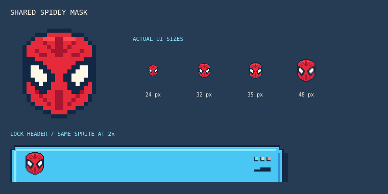
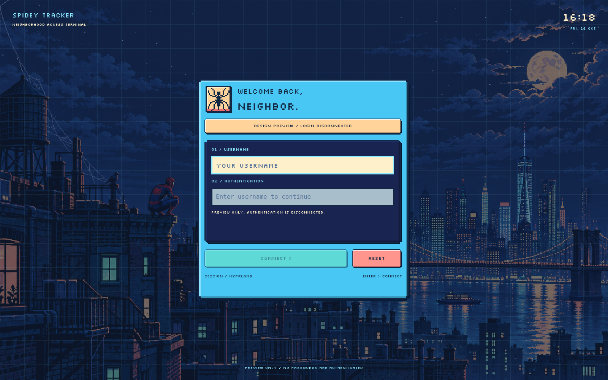

# Lock screen, boot login and wallpaper

The lock screen and graphical login share the desktop's cyan pixel frames, navy panels, peach keys and pixel badges. The graphical login uses the same broad-bodied spider emblem as the desktop. Hyprlock protects an existing session. For boot login, Quickshell renders a greetd prompt inside a restricted Sway session; greetd handles authentication through PAM and starts Hyprland after successful authentication. Installing the desktop rice does not change your login manager.

## Lock screen

Install the packages and dotfiles using the [first-install instructions](../README.md#install-on-arch-linux), then press `Super + L` or click the dock's lock button. You can also launch the same action from a terminal:

```sh
python3 "${XDG_CONFIG_HOME:-$HOME/.config}/quickshell/spidey/scripts/system.py" action lock
```

The action supplies the panel artwork, bundled city wallpaper and Silkscreen font paths to Hyprlock. Its header uses the same red Spidey mask, white eyes and navy outline as the desktop icons. The font is scoped to the lock process. The password field uses a regular monospace font for readability, with mint authentication, coral failure and peach Caps Lock indicators. Hyprlock continues using Arch's PAM configuration.



Customize [hyprlock.conf](../config/hypr/hyprlock.conf) and [the panel artwork generator](../tools/generate-lock-assets.py). After editing the shared mask drawing, rebuild both committed assets with `python3 tools/generate-icons.py` and `python3 tools/generate-lock-assets.py`. Normal installs and updates use the bundled files. Keep using the lock action when launching this theme: a bare `hyprlock` command does not receive its asset and font paths. If you already use an idle manager, set its lock command to the action above; the rice does not install or configure idle locking.

## Generated wallpaper

The bundled [city wallpaper](../assets/wallpapers/spidey-city.png) is a 1672 × 941 PNG with a navy sky, peach moon, cyan windows and a small rooftop Spidey. The lock screen and graphical login use it automatically; your desktop wallpaper remains under your existing wallpaper manager.


Select this PNG in your wallpaper manager. For example, from the checkout with your existing `awww-daemon` running:

```sh
awww img "$PWD/assets/wallpapers/spidey-city.png"
```

If you use swww, use `swww img` with the same path. Set that image in your existing wallpaper startup configuration to keep it across logins.

## Graphical boot login with greetd

This is an optional replacement for Ly. It uses a root-owned snapshot rather than loading code from your writable checkout. Keep Ly installed for rollback. A Quickshell panel by itself cannot authenticate a user or securely lock a session; this greeter uses `Quickshell.Services.Greetd` and the real greetd conversation.



Install the additional packages on Arch, after completing the desktop installation:

```sh
sudo pacman -Syu --needed greetd sway quickshell qt6-svg ttf-dejavu dbus python
```

Preview the layout in your current desktop without contacting greetd or authenticating:

```sh
SPIDEY_GREETER_PREVIEW=1 qs -p "$PWD/greeter"
```

Use `quickshell` in place of `qs` if needed. The preview is labeled and cannot start a session.

### Install and review

Run these commands from the checkout:

```sh
bash scripts/install-login.sh --dry-run --backup
sudo bash scripts/install-login.sh --install --backup
```

`--backup` preserves any existing greetd configuration before replacing it. Without it, unrelated destination files stop installation. The script copies the greeter, font, icons and wallpaper to `/usr/local/share/spidey-greeter/` and installs `/etc/greetd/config.toml`. It leaves services unchanged. Without `--install` or `--enable`, the script only prints a dry run.

Review these installed settings before enabling it:

| File | Setting |
| --- | --- |
| `/usr/local/share/spidey-greeter/greeter/session.json` | Session command, session environment and optional default username. |
| `/usr/local/share/spidey-greeter/sway.conf` | Login-screen keyboard layout and output settings. |
| `/etc/greetd/config.toml` | greetd's greeter command, `greeter` account and virtual terminal. |

The default session command is `["dbus-run-session", "Hyprland"]`. It loads your normal user configuration, including the rice load line added during desktop installation. The login screen starts with an empty username; `defaultUser` can prefill it. Store no passwords in these files. Command arguments are a JSON array, not shell syntax.

For a Brazilian keyboard, uncomment `input type:keyboard xkb_layout br` in the installed `sway.conf`. Your Hyprland keyboard settings apply after login; the greeter has its own layout.

### Enable for the next boot

```sh
sudo bash scripts/install-login.sh --enable --dry-run
sudo bash scripts/install-login.sh --enable
```

The script checks the required programs and greetd account, disables enabled Ly service units and enables `greetd.service`. It never uses `--now`, stops Ly or closes your desktop. Reboot when ready. If another display manager is configured, the script stops before changing it.

Use your Linux username and password at the prompt. Authentication errors let you retry; the cancel control clears the conversation. Password responses are masked and passed to greetd, not saved in the theme configuration.

### Updates and rollback

Complete the [desktop update](../README.md#updating-either-previous-version) first. If you already installed this graphical greetd login, refresh its separate system snapshot from the checkout:

```sh
sudo pacman -Syu --needed greetd sway quickshell qt6-svg ttf-dejavu dbus python
bash scripts/install-login.sh --install --dry-run
sudo bash scripts/install-login.sh --install
```

Customized `greeter/session.json`, `sway.conf` and the managed greetd configuration are preserved. Replaced snapshots and configurations have adjacent `.spidey-backup.*` copies. The ordinary desktop installer does not refresh this separate system installation. Run this refresh to bring the updated spider badge into an already-installed greeter. Updating does not need `--enable` again; the new appearance appears the next time the login screen starts. Skip these commands if you kept Ly or another login manager.

To return to Ly, switch to a TTY such as `Ctrl + Alt + F3`, log in and run:

```sh
sudo systemctl disable greetd.service
sudo systemctl enable ly@tty2.service
```

Current Arch Ly uses `ly@tty2.service`. If your installation uses a different Ly unit, use the original unit printed by the installer; it is also recorded in `/usr/local/share/spidey-greeter/service-before-enable.json`. Reboot to return to Ly. These commands leave the current session running. To restore an earlier greetd setup instead, restore its adjacent configuration backup and enable its original service.

## Keep Ly and theme it

Ly remains a text login screen, so it can use matching colors and text but cannot display the graphical greeter or wallpaper. Keep it by skipping the greetd installer.

Back up your existing Ly configuration, then merge the relevant palette fragment into it:

- Current Arch Ly 1.4.x, `/etc/ly/config.ini`: [spidey.ini](../config/ly/spidey.ini).
- A newer Ly build using `/etc/ly/config.lua`: [spidey.lua](../config/ly/spidey.lua), after your existing `ly = { ... }` block.

These are palette fragments, not complete configurations. Keep your session and authentication settings. The theme takes effect the next time Ly starts; there is no need to stop your desktop to apply it.
