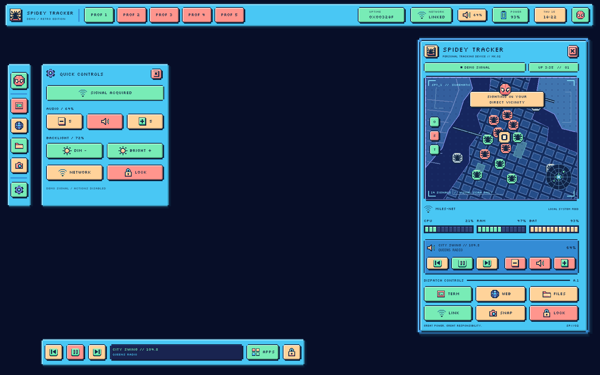

# Spidey Tracker — retro UI

The `feat/spidey-tracker-retro` branch adds a second rice based on the supplied tracker photo: cyan framing, deep navy panels, salmon and mint buttons, stepped pixel edges, and tiny bitmap icons. The focus is the bar, buttons and tracker interface. Wallpaper stays your choice.



The original rice remains on `main` and remains available in this branch under `quickshell/`, `config/hypr/` and its existing installers. The new shell lives in `quickshell-retro/`; installing it does not replace the original links or edit your main Hyprland configuration.

## Install and select the retro shell

Use a working Linux Hyprland session with Quickshell 0.2.1+, Qt 6, Python 3.10+, Bash and GNU coreutils. The pixel font and icons are bundled. See the [original requirements](../README.md#requirements) for distribution package names. Audio, brightness, media, launching applications and locking use optional desktop tools; keep the tools and services you already use.

```sh
git switch feat/spidey-tracker-retro
bash scripts/install-retro.sh --dry-run
bash scripts/install-retro.sh
```

Keep this checkout in place because installation uses symlinks:

| Installed path | Source |
| --- | --- |
| `~/.config/quickshell/spidey-retro` | `quickshell-retro/` |
| `~/.config/hypr-spidey-retro` | `config/hypr-retro/` |

The default root is `${XDG_CONFIG_HOME:-$HOME/.config}`. To use another root, pass `--config-root /absolute/path` and export `XDG_CONFIG_HOME` to that path when starting Quickshell or the Lua starter. For the legacy config, set `$spideyRetroConfigRoot` to that absolute path.

Existing destination files stop installation before links are created. `--backup` moves conflicts to unique `.spidey-retro-backup.*` paths. `--dry-run` creates nothing, including when combined with `--backup`. No packages or services are installed.

Check `hyprctl version`. For **Hyprland 0.55+**, load this from your existing Lua config:

```lua
local config_root = os.getenv("XDG_CONFIG_HOME") or (os.getenv("HOME") .. "/.config")
dofile(config_root .. "/hypr-spidey-retro/rice.lua")({ config_root = config_root })
```

For **Hyprland 0.48–0.54**, add this to your `hyprland.conf`:

```ini
$spideyRetroConfigRoot = ~/.config
source = $spideyRetroConfigRoot/hypr-spidey-retro/rice.conf
```

Choose one rice's source and autostart lines at a time. If switching from the original, remove its `hypr-spidey/rice.*` source line and stop that running shell (`qs -c spidey kill`) before starting the retro shell. Its installed files can remain for switching back. Review binding conflicts with your existing config.

Reload Hyprland, then start the shell manually in an existing session:

```sh
hyprctl reload
qs -c spidey-retro
```

Replace `qs` with `quickshell` if that is your executable name. On a new session the retro snippet starts the shell automatically. It sets square 3px cyan/navy window borders and never starts or replaces a wallpaper. Kitty and Hyprlock use your existing configurations.

Complete starter configs are also supplied; choose the format for your installed Hyprland:

```sh
# Hyprland 0.55+
Hyprland --config ~/.config/hypr-spidey-retro/hyprland.lua

# Hyprland 0.48–0.54
Hyprland --config ~/.config/hypr-spidey-retro/hyprland.conf
```

The starter keyboard layout is `us`; edit your own main configuration to select `br` or another layout.

## Preview and controls

The top bar uses colored profile buttons for workspaces 1–5 (1–3 on narrow screens). A left rail opens the tracker, terminal, browser, files, screenshot selection and quick settings. The bottom dock holds media controls, the `APPS` launcher and screen lock.

The tracker and quick settings panels start open and can be closed independently. The gear button toggles quick settings with volume, brightness, network settings and screen lock. Inside the tracker, `O`, `S` and `T` toggle local map overlays. These controls change the decorative map view.

Preview the UI without installing links or changing your desktop:

```sh
SPIDEY_PREVIEW=1 SPIDEY_DEMO=1 qs -p "$PWD/quickshell-retro"
```

The [windowed preview](retro-preview.png) shows the UI over a simple presentation grid. Demo mode supplies sample telemetry and disables desktop actions. Live mode uses the machine's statistics and available devices. The city map and tracker targets are decorative, not location tracking.

On shorter displays, scroll inside the tracker to reach its lower controls; buttons and labels keep their pixel size. The layout was checked at 1600×1000 and 1366×768. For a window at another size, set `SPIDEY_PREVIEW_WIDTH` and `SPIDEY_PREVIEW_HEIGHT` alongside the preview flags.

Save a headless screenshot using Quickshell with its Qt dependencies installed:

```sh
QT_QPA_PLATFORM=offscreen QT_QUICK_BACKEND=software \
  SPIDEY_PREVIEW=1 SPIDEY_DEMO=1 \
  SPIDEY_SCREENSHOT="$PWD/docs/retro-preview.png" qs -p "$PWD/quickshell-retro"
```

| Shortcut | Action |
| --- | --- |
| `Super + D` | Toggle the tracker dashboard. |
| `Super + Enter` | Open Kitty using your normal config. |
| `Super + Space` | Open Fuzzel with the cyan/navy palette. |
| `Super + E` | Open your home folder. |
| `Super + Q`, `Super + F`, `Super + V` | Close, fullscreen, toggle floating. |
| `Super + arrows` | Move focus; add Shift to move the window. |
| `Super + 1…0` | Select workspace; add Shift to move the window there. |
| `Super + L` | Run Hyprlock using your normal config. |
| `Print` | Select a screenshot region and copy it to the clipboard. |

Dashboard IPC uses the retro config name:

```sh
# Toggle the tracker
qs -c spidey-retro ipc call dashboard toggle
# Toggle quick settings
qs -c spidey-retro ipc call dashboard controls
```

Volume, brightness and media keys use `wpctl`, `brightnessctl` and `playerctl`. Fuzzel, Kitty, Hyprlock, screenshot tools and other launch targets remain optional system dependencies. Hardware controls and native Hyprland behavior need a real desktop session for validation.

## Remove or switch back

```sh
bash scripts/uninstall-retro.sh --dry-run
bash scripts/uninstall-retro.sh
```

Remove the retro source/autostart lines you added. The uninstaller removes only matching retro symlinks, leaves the original rice intact, and preserves backups and unrelated files. To return to the original, stop the running retro shell (`qs -c spidey-retro kill`) and use the original source/startup instructions in the [README](../README.md#existing-hyprland-desktop).

The assets are an unofficial fan interpretation of the supplied reference photo. The bundled font retains its SIL Open Font License alongside the font files.

## Development checks

```sh
python3 -m unittest discover -s tests -v
bash -n scripts/install-retro.sh scripts/uninstall-retro.sh
```

**35 backend and installer tests passed**, including seven retro installer integration tests. Real demo and live telemetry renders passed with Quickshell 0.2.1 and Qt 6.8.2. Production layer-shell panels and dashboard/quick-settings IPC were verified under headless Sway. `retro-desktop.png` shows those actual panels; `retro-preview.png` shows the optional windowed preview.

The retro installer tests exercise both installation orders, independent removal, repeat installation, dry runs, preflight conflicts, backups, broken links, and preservation of foreign files. They use temporary config roots with spaces and an apostrophe. The original installer tests remain unchanged. Lua 5.4 loading and mocked startup/IPC execution also verified that the quoted config root and `spidey-retro` name reach the shell correctly. Native Hyprland behavior and hardware actions remain untested in the cloud environment.
